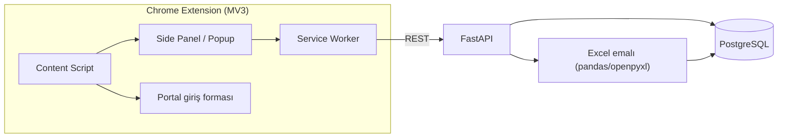
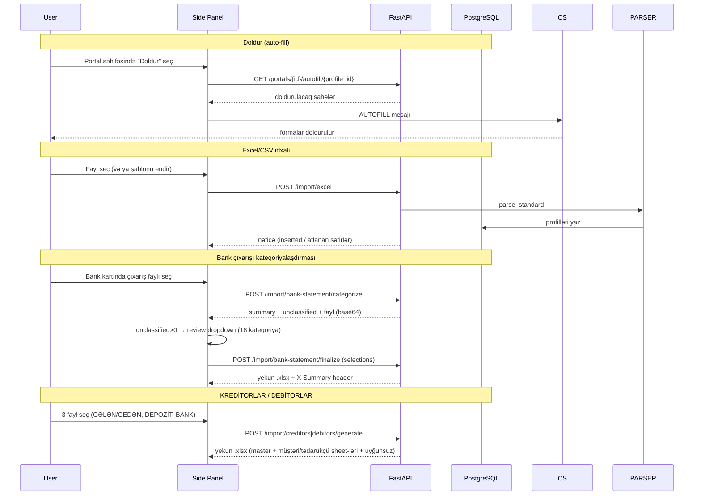

# TaxPro

Azərbaycanın dövlət və bank portalları üçün Chrome uzantısı. Seçilmiş profilin **Telefon** və **Asan ID**
məlumatlarını portal giriş formalarını avtomatik doldurur, profilləri idarə edir və Excel/CSV
faylından toplu profil idxalını təmin edir. Profil 3 sahədən ibarətdir: **Ad Soyad, Telefon, Asan ID**.

Bundan əlavə, deterministik (AI/ML-siz) **maliyyə emalı** modulları var:
- **Bank çıxarışı kateqoriyalaşdırması** (18 kateqoriya, 14 bank profili),
- **KREDİTORLAR (Gələn)** — satınalma qaimələri + bank/depozit məxaric uzlaşdırması,
- **DEBİTORLAR (Gedən)** — göndərilən qaimələr + bank/depozit mədaxil uzlaşdırması.

## Xüsusiyyətlər

- **Portal Auto-fill** — "Doldur" tab-ı: aktiv səhifədəki portal üçün seçilmiş profilin Telefon + Asan ID sahələrini formalara yazır (telefon prefiksi ayrıca select/dropdown olan formalarda avtomatik uyğunlaşdırılır).
- **Qeydiyyat rejimi** — istifadəçi portal formasında sahə seçir, selector eşləmələri DB-yə yazılır (dəfələrlə istifadə üçün).
- **Profil idarəetməsi** — CRUD: Ad Soyad, Telefon, Asan ID.
- **Excel idxalı** — tək formatlı deterministik emal (.xlsx/.xls/.csv); telefon normallaşdırması, tarix dəstəyi, əskik-sütun xətası dəqiq göstərilir; nümunə şablon endirmə.
- **Bank çıxarışı kateqoriyalaşdırması** — 14 bank format profili avtomatik tanınır (YapıKredi, Turan, Kapital, Yelo, Access, VTB, Ziraat, ATB, Unibank, Rabitə, Bank of Baku, Pasha, Bank Respublika, ABB); 2-mərhələli axın: `categorize` (xülasə + unclassified + fayl) → `finalize` (manual təsnifat override → yekun .xlsx). AI/ML yoxdur — tam deterministik pattern-matching.
- **KREDİTORLAR (Gələn)** — GƏLƏN (alınan/satınalma qaimələri) + DEPOZİT (məxaric) + BANK ÇIXARIŞI (debit) fayllarını VÖEN üzrə uzlaşdırır: `Hesablanıb − Ödənilib = Qalıq`. Master sheet + hər tədarükçü üçün ayrı sheet (hiperlink + SUM formulları) + "Uyğunsuz ödənişlər" sheet.
- **DEBİTORLAR (Gedən)** — GEDƏN (göndərilən qaimələr) + DEPOZİT (mədaxil) + BANK ÇIXARIŞI (kredit) fayllarını eyni infrastrukturlə, əks istiqamətdə uzlaşdırır: `Hesablanıb − Ödənilib = Qalıq`. Bank debit tərəfi (müştəriyə geri ödəmə) V1-də nəzərə alınmır.
- **30 portal** üçün domen əsaslı favicon + statik logo override-ları (hərf-avatar fallback ilə).

## Arxitektura



## Fayl strukturu

```
taxpro-backend/
├── app/
│   ├── api/v1/endpoints/    # REST: profiles, portals, import/excel,
│   │                        #       import/bank-statement (categorize+finalize),
│   │                        #       import/creditors/generate, import/debitors/generate
│   ├── core/                # config (pydantic-settings), database, logging
│   ├── models/              # SQLAlchemy: Profile, Portal
│   ├── schemas/             # Pydantic v2 sxemləri (BankStatementSummary — 18 kateqoriya)
│   ├── services/deterministic/  # excel_parser, bank_statement_categorizer,
│   │                            #   creditors (KREDİTORLAR + DEBİTORLAR), phone,
│   │                            #   autofill_service, portal_service, profile_service
│   └── main.py
├── alembic/versions/        # Miqrasiyalar 0001–0019 (seed + URL/logo + profil sadələşdirmə)
├── tests/                   # pytest inteqrasiya testləri (conftest real DB); 314 test funksiyası
├── Dockerfile · alembic.ini · requirements.txt · .env.example

taxpro-extension/
├── manifest.json            # Manifest V3
├── background.js            # Service worker (tab, autofill, record)
├── content-scripts/autofill.js  # Səhifəyə enjeksiya
├── popup/                   # Side Panel UI: popup.html/css/js, tabs/import.js, tabs/creditors.js
├── options/                 # Tənzimləmələr (backend URL)
├── lib/api.js               # REST müştərisi
└── assets/icons/            # Brend ikonları (16/32/48/128)
```

## Texnologiyalar

| Təbəqə | Texnologiya |
|---|---|
| API | FastAPI, Pydantic v2, SQLAlchemy v2 (async) |
| DB | PostgreSQL, Alembic |
| Emal | pandas + openpyxl (Excel idxalı + bank/kreditor/debitor emalı) |
| Infra | Docker (backend + db) |
| Extension | Manifest V3, vanilla JS, Chrome Side Panel API |

## İş axını



## Bank çıxarışı kateqoriyalaşdırması

Deterministik emal — AI/ML yoxdur, yalnız sabit pattern-matching. Format profilləri `_FORMAT_PROFILES`-də
avtomatik tanınır (hər bank üçün unikal required header token-ləri; profillər bir-birinə qarışmır).

**18 kateqoriya (prioritet sırası):** Nağd çəkim komissiyası · KOMİSİYA · BANK FAİZ XƏRCİ · ƏDV ÖDƏNİŞİ ·
RÜSUM · VERGİ MƏXARİC · MAAŞ MƏXARİC · TƏSİSÇİDƏN BORC · Hesab Möhkəmlənməsi · Nağdlaşdırma ·
Konvertasiya · Bank xərci · Divident ödəniş · Pos terminal məxaric (pasha) · Kredit ödənişi (pasha) ·
DİGƏR ŞİRKƏT DAXİL OLMALAR · DİGƏR ŞİRKƏT ÖDƏNİŞLƏRİ · Terminal-Komissiya (kapital).

**Dəstəklənən format profilləri (14):**

| Profil | Bank | Header qeydləri |
|---|---|---|
| `standard` | YapıKredi / ümumi | Əməliyyat Detalları + Debit/Kredit |
| `turan` | Turan Bank | Tək "Məbləğ" (mənfi=məxaric); sender-siz catch-all |
| `kapital` | Kapital Bank | № / Tarix / Məbləğ / Təyinat; Terminal-Komissiya |
| `yelo` | Yelo Bank | Mədaxil/Məxaric ayrı, Ödəyən/alan sender; Əsas ödəmə → kateqoriyasız |
| `access` | Access Bank | Header 2-ci sətirdə; Göndərənin/Alanın Adı sender |
| `vtb` | VTB Bank | Debet/Kredit ayrı; kiril "Комиссия за срочность" → KOMİSİYA |
| `ziraat` | Ziraat Bank | Müxbirin adı sender; CƏMİ/Çıxış qalıq atlanır |
| `atb` | ATB Bank | Müxbir sender; "Xidmet Haqqi" yalnız debit-də KOMİSİYA |
| `unibank` | Unibank | Tərəfdaş sender; "konvertasiya" debit-də KOMİSİYA; sender-siz catch-all |
| `rabite` | Rabitə Bank | Qarşı tərəfin adı sender; "Haqq və komissiya gəlirləri" → KOMİSİYA |
| `bankofbaku` | Bank of Baku | Profit/Expenditure; Debet Account sender |
| `pasha` | Pasha Bank | Mədaxil/Məxaric ayrı, Ödəyən/Benefisiar sender; "xidmət haqqı"/"Charge" debit-də KOMİSİYA; "Interest Payment" → BANK FAİZ; "Salary"+debit → MAAŞ; "Pos"+kredit → Pos terminal məxaric; "Loan Payment" → Kredit ödənişi |
| `bankrespublika` | Bank Respublika | Kredit/Debet ayrı; "xidmət haqqı" debit-də KOMİSİYA; "faiz/cərimə ∧ kredit" → BANK FAİZ; "tesisciden" → TƏSİSÇİDƏN BORC; "əsas borc" → kateqoriyasız |
| `abb` | ABB | Header 42-ci sətirdə; "Standing payment order" (kredit) → DAXİL; "sadeleshmis"+negdmexaric → Nağd çəkim; balans sütunu yoxdur |

**2-mərhələli axın:**
1. `POST /import/bank-statement/categorize` → `{summary, unclassified[], file_base64}` — hər kateqoriya üzrə
   say/cəm; tanınmayan sətirlər unclassified siyahısında.
2. `POST /import/bank-statement/finalize` (multipart: fayl + `selections` JSON) → yekun .xlsx
   (Kateqoriya + İcmal sütunları, "Xülasə" sheet-i) + `X-Summary` header.

Extension-ın "Bank Çıxarışı" tab-ında hər bank üçün müstəqil kart + unclassified>0 olduqda review
(18 kateqoriya dropdown + "Təsdiqlə və yenidən yüklə").

## KREDİTORLAR / DEBİTORLAR modulu

`app/services/deterministic/creditors.py` — 3 mənbə faylı VÖEN üzrə deterministik uzlaşdırır və
TƏK nəticə workbook-u yaradır (AI/ML yoxdur). **Stateless** — DB-yə yazmır.

- **KREDİTORLAR (Gələn):** `Hesablanıb (GƏLƏN) − Ödənilib (bank DEBIT + depozit MƏXARİC) = Qalıq`.
- **DEBİTORLAR (Gedən):** `Hesablanıb (GEDƏN) − Ödənilib (bank KREDİT + depozit MƏDAXİL) = Qalıq`.

**Çoxbanklı parser** (KREDİTORLAR + DEBİTORLAR eyni infrastruktur): `_detect_bank_header` alias-larla
`date / voen / name / desc / debit / signed / credit` sütunlarını tapır. `parse_bank_statement(raw, direction)`
`direction="debit"` (Kreditorlar) və ya `"credit"` (Debitorlar) ilə eyni xəritədən istiqaməti oxuyur.
`parse_depozit(raw, direction)` `"expense"` (Məxaric) / `"income"` (Mədaxil). `parse_gelen` GƏLƏN və GEDƏN
üçün ortaqdır. VTB/ATB/Ziraat üçün preamble-dən dinamik "öz VÖEN" skip (`_detect_preamble_family` +
`_detect_self_voens`).

**Real fixture-larla təsdiqlənmiş debit (Kreditorlar) sayları:** ABB 0 · Access 154 · ATB 207 ·
Bank of Baku 54 · Bank Respublika 43 · Kapital 50 · PAŞA 43 · Rabitə 53 · Turan 11 · Unibank 74 ·
VTB 32 · Yapı Kredi 3 · Yelo 31 · Ziraat 43.

**Nəticə workbook:** master sheet (**KREDİTORLAR** / **DEBİTORLAR**) + hər tərəf üçün ayrı sheet
(hiperlink + SUM formulları, geri-link `← KREDİTORLAR` / `← DEBİTORLAR`) + "Uyğunsuz ödənişlər" sheet.
B sütununun görünən mətni həmişə əsl addır; hyperlink hədəfi arxada saxlanılır.

**Endpoint-lər:** `POST /import/creditors/generate` (`gelen`, `depozit`, `bank`) və
`POST /import/debitors/generate` (`gedeni`, `depozit`, `bank`) → `.xlsx` stream.

## Təhlükəsizlik qeydləri

- **Profil yalnız 3 sahə:** Ad Soyad, Telefon, Asan ID. VÖEN/PIN/PUK/bitmə tarixi/rəng/ikon/qeyd modeldən və DB-dən çıxarılıb (0013 miqrasiyası).
- **Autofill yalnız seçimlə:** doldurma məhz istifadəçinin seçdiyi profil + aktiv portal cütü üçün baş verir; sayta yalnız Telefon və Asan ID yazılır.

## Testlər və işə salma

```bash
cd taxpro-backend
docker compose up -d db            # testlər real Postgres tələb edir (taxpro_test yenidən yaradılır)
python -m pytest -q                # 314 test funksiyası (parametrləşdirmə ilə ~334 keçid)
```

Backend + DB:
```bash
docker compose up -d --build backend
# Health: http://localhost:8000/health
```

## Dəstəklənən Portallar (30)

**Dövlət (9):** e-Vergi, Vergi xidməti, e-Sosial, e-customs, Statistika, AYNA, myGov, MyGovID, Asan İmza Portalı

**Banklar (21):** ABB, Access Bank, AFB Bank, Azər-Türk Bank, Bank Avrasiya, Bank of Baku, Bank Respublika,
Birbank Biznes, BMI Baku, BTB Bank, Expressbank, PashaBank Digital, Premium Bank, Rabitabank, Turanbank,
Unibank, VTB Bank, Xalq Bank, Yapı Kredi Bank, Yelo Bank, Ziraat Bank
