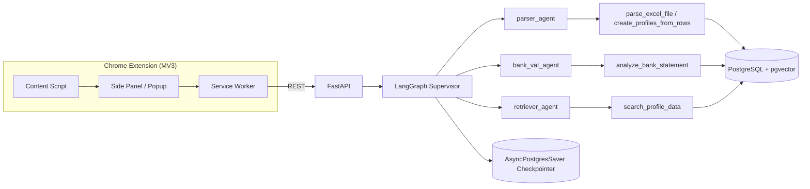
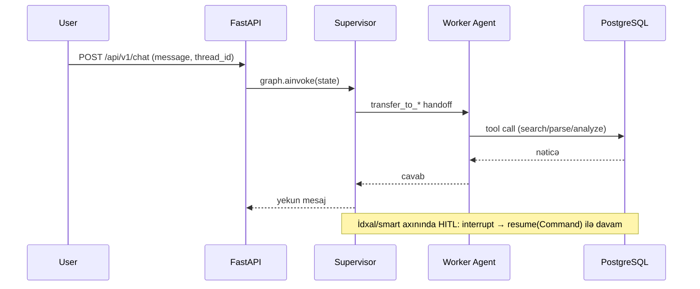

# TaxPro

Azərbaycanın dövlət və bank portalları üçün Chrome uzantısı + AI köməkçisi. Seçilmiş profil məlumatlarını
(Asan ID, VÖEN, telefon və s.) portal giriş formalarını avtomatik doldurur, Excel/bank çıxarışlarını emal edir
və məlumatlarla bağlı suallara yalnız yerli bazaya əsaslanaraq cavab verir.

## Xüsusiyyətlər

- **Portal Auto-fill** — "Doldur" tab-ı: aktiv səhifədəki portal üçün seçilmiş profilin sahələrini formalara yazır.
- **Qeydiyyat rejimi** — istifadəçi portal formasında sahə seçir, selector eşləmələri DB-yə yazılır (dəfələrlə istifadə üçün).
- **Excel idxalı** — standart şablon üzrə deterministik emal + "Qarışıq fayl (AI ilə)" rejimi (parser agenti, yazmadan əvvəl təsdiq/HITL).
- **Bank çıxarışı analizi** — bank agenti Excel/PDF çıxarışından ümumi məbləğ, ƏDV və daxilolma hissələrini hesablayır.
- **AI Çat (RAG)** — Supervisor + worker agent-lər; suallara yalnız DB-dəki profillər/sənədlər əsasında cavab.
- **Profil idarəetməsi** — CRUD, rəng/ikon seçimi; PIN/PUK Fernet ilə şifrələnir.
- **30 portal** üçün domen əsaslı favicon + statik logo override-ları (hərf-avatar fallback ilə).

## Arxitektura



## Fayl strukturu

```
taxpro-backend/
├── app/
│   ├── api/v1/endpoints/    # REST: profiles, portals, chat, import/excel, bank-statements, resume
│   ├── core/                # config (pydantic-settings), database, security (Fernet), logging
│   ├── models/              # SQLAlchemy: Profile, Portal, VectorDocument
│   ├── schemas/             # Pydantic v2 sxemləri
│   ├── services/
│   │   ├── ai/              # LangGraph: graph, supervisor, agents/, tools/, middleware/, state, checkpointer, llm
│   │   └── deterministic/   # excel_parser, autofill, portal_service, profile_service
│   └── main.py
├── alembic/versions/        # Miqrasiyalar 0001–0009 (seed + URL/logo düzəlişləri)
├── tests/                   # pytest inteqrasiya testləri (conftest real DB)
├── Dockerfile · alembic.ini · requirements.txt · .env.example

taxpro-extension/
├── manifest.json            # Manifest V3
├── background.js            # Service worker (tab, autofill, record)
├── content-scripts/autofill.js  # Səhifəyə enjeksiya
├── popup/                   # Side panel UI: popup.html/css/js, tabs/chat.js, tabs/import.js
├── options/                 # Tənzimləmələr (backend URL)
├── lib/                     # api.js, hitl.js
└── assets/icons/            # Brend ikonları (16/32/48/128)
```

## Texnologiyalar

| Təbəqə | Texnologiya |
|---|---|
| API | FastAPI, Pydantic v2, SQLAlchemy v2 (async) |
| DB | PostgreSQL + pgvector, Alembic |
| AI | LangGraph (`create_agent`/`create_supervisor`), LangChain, Groq / Anthropic |
| Infra | Docker (backend + pgvector) |
| Extension | Manifest V3, vanilla JS, Chrome Side Panel API |

## AI axını



## Təhlükəsizlik qeydləri

- **Şifrələmə:** PIN/PUK kimi gizli sahələr Fernet (`ENCRYPTION_KEY`) ilə şifrələnir (`enc:` prefiks) və çat/UI-də maskalanır.
- **DB-yə bağlı cavab:** retriever agent yalnız `search_profile_data` tool-u ilə DB-dən alınan məlumatı təqdim edir; gizli sahələr açıqlanmır.
- **Hallüsinasiya qorunması:** `RetrieverGuard` cavabdakı ≥5 rəqəmli ardıcıllıqları cari turdakı axtarış nəticəsi ilə müqayisə edir, uyğun gəlməyəni (və ya təzə axtarışsız cavabı) bloklayır.
- **Kontekst izolyasiyası:** `FreshContextMiddleware` sub-agentlərin yalnız cari turun kontekstini görməsini təmin edir (köhnə nəticələrlə uydurma cavabın qarşısı).

## Dəstəklənən Portallar (30)

**Dövlət (9):** e-Vergi, Vergi xidməti, e-Sosial, e-customs, Statistika, AYNA, myGov, MyGovID, Asan İmza Portalı

**Banklar (21):** ABB, Access Bank, AFB Bank, Azər-Türk Bank, Bank Avrasiya, Bank of Baku, Bank Respublika,
Birbank Biznes, BMI Baku, BTB Bank, Expressbank, PashaBank Digital, Premium Bank, Rabitabank, Turanbank,
Unibank, VTB Bank, Xalq Bank, Yapı Kredi Bank, Yelo Bank, Ziraat Bank
