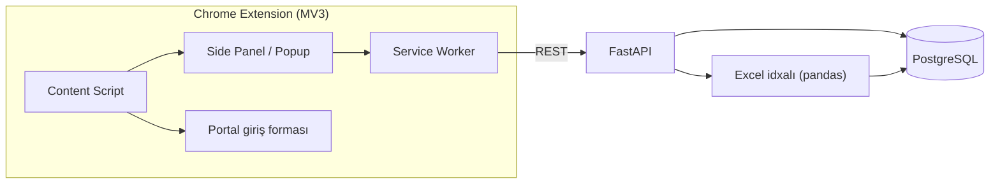
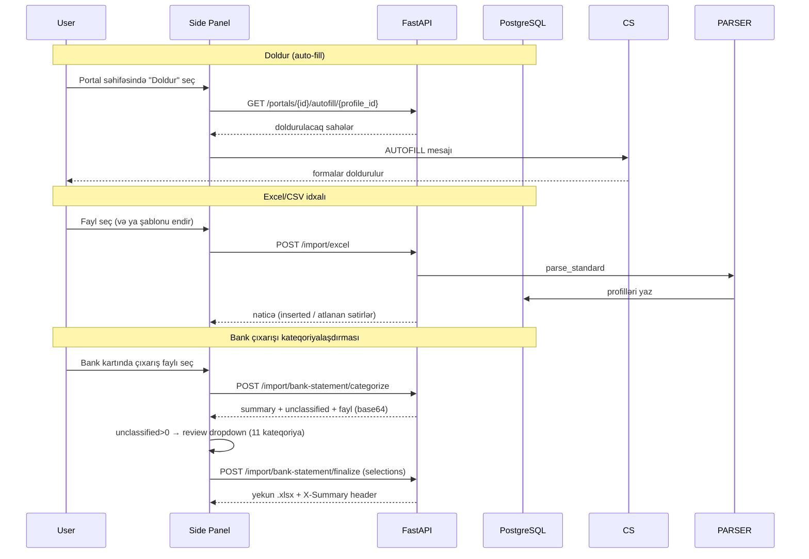

# TaxPro

Azərbaycanın dövlət və bank portalları üçün Chrome uzantısı. Seçilmiş profil məlumatlarını
(Asan ID, VÖEN, telefon, PIN/PUK və s.) portal giriş formalarını avtomatik doldurur, profilləri
idarə edir və Excel/CSV faylından toplu profil idxalını təmin edir.

## Xüsusiyyətlər

- **Portal Auto-fill** — "Doldur" tab-ı: aktiv səhifədəki portal üçün seçilmiş profilin sahələrini formalara yazır.
- **Qeydiyyat rejimi** — istifadəçi portal formasında sahə seçir, selector eşləmələri DB-yə yazılır (dəfələrlə istifadə üçün).
- **Profil idarəetməsi** — CRUD, rəng/ikon seçimi; PIN/PUK Fernet ilə şifrələnir, siyahılarda maskalanır.
- **Excel idxalı** — tək formatlı deterministik emal (.xlsx/.xls/.csv); telefon normallaşdırması, tarix dəstəyi, əskik-sütun xətası dəqiq göstərilir; nümunə şablon endirmə.
- **Bank çıxarışı kateqoriyalaşdırması** — 11 bank format profili avtomatik tanınır (YapıKredi, Turan, Kapital, Yelo, Access, VTB, Ziraat, ATB, Unibank, Rabitə, Bank of Baku); 2-mərhələli axın: `categorize` (xülasə + unclassified + fayl) → `finalize` (manual təsnifat override → yekun .xlsx). AI/ML yoxdur — tam deterministik pattern-matching.
- **30 portal** üçün domen əsaslı favicon + statik logo override-ları (hərf-avatar fallback ilə).

## Arxitektura



## Fayl strukturu

```
taxpro-backend/
├── app/
│   ├── api/v1/endpoints/    # REST: profiles, portals, import/excel, import/bank-statement (categorize+finalize)
│   ├── core/                # config (pydantic-settings), database, security (Fernet), logging
│   ├── models/              # SQLAlchemy: Profile, Portal
│   ├── schemas/             # Pydantic v2 sxemləri (BankStatementSummary — 11 kateqoriya)
│   ├── services/deterministic/  # excel_parser, bank_statement_categorizer, autofill_service, portal_service, profile_service
│   └── main.py
├── alembic/versions/        # Miqrasiyalar 0001–0012 (seed + URL/logo düzəlişləri + telefon normallaşdırma)
├── tests/                   # pytest inteqrasiya testləri (conftest real DB)
├── Dockerfile · alembic.ini · requirements.txt · .env.example

taxpro-extension/
├── manifest.json            # Manifest V3
├── background.js            # Service worker (tab, autofill, record)
├── content-scripts/autofill.js  # Səhifəyə enjeksiya
├── popup/                   # Side panel UI: popup.html/css/js, tabs/import.js
├── options/                 # Tənzimləmələr (backend URL)
├── lib/api.js               # REST müştərisi
└── assets/icons/            # Brend ikonları (16/32/48/128)
```

## Texnologiyalar

| Təbəqə | Texnologiya |
|---|---|
| API | FastAPI, Pydantic v2, SQLAlchemy v2 (async) |
| DB | PostgreSQL, Alembic |
| Emal | pandas + openpyxl (Excel/CSV idxalı + bank çıxarışı kateqoriyalaşdırması), cryptography (Fernet) |
| Infra | Docker (backend) |
| Extension | Manifest V3, vanilla JS, Chrome Side Panel API |

## İş axını



## Bank çıxarışı kateqoriyalaşdırması

Deterministik emal — AI/ML yoxdur, yalnız sabit pattern-matching. Format profilləri `_FORMAT_PROFILES`-də
avtomatik tanınır (hər bank üçün unikal required header token-ləri; profillər bir-birinə qarışmır).

**11 kateqoriya (prioritet sırası):** Nağd çəkim komissiyası · KOMİSİYA · BANK FAİZ XƏRCİ · ƏDV ÖDƏNİŞİ ·
RÜSUM · VERGİ MƏXARİC · MAAŞ MƏXARİC · TƏSİSÇİDƏN BORC · DİGƏR ŞİRKƏT DAXİL OLMALAR ·
DİGƏR ŞİRKƏT ÖDƏNİŞLƏRİ · Terminal-Komissiya (kapital).

**Dəstəklənən format profilləri (11):**

| Profil | Bank | Header qeydləri |
|---|---|---|
| `standard` | YapıKredi / ümumi | Əməliyyat Detalları + Debit/Kredit |
| `turan` | Turan Bank | Tək "Məbləğ" (mənfi=məxaric); sender-siz catch-all |
| `kapital` | Kapital Bank | № / Tarix / Məbləğ / Təyinat; Terminal-Komissiya |
| `yelo` | Yelo Bank | Mədaxil/Məxaric ayrı, Ödəyən/alan sender; Əsas ödəmə → kateqoriyasız |
| `access` | Access Bank | Header 2-ci sətirdə; Göndərənin/Alanın Adı sender |
| `vtb` | VTB Bank | Debet/Kredit ayrı; kiril "Комиссия за срочность" → KOMİSİYA |
| `ziraat` | Ziraat Bank | Müxbirin adı sender; CƏMİ/Çıxış qalıq atlanır |
| `atb` | ATB Bank | Müxbir sender; "Xidmet Haqqi" yalnız debit-də KOMİSİYA |
| `unibank` | Unibank | Tərəfdaş sender; "konvertasiya" debit-də KOMİSİYA; sender-siz catch-all |
| `rabite` | Rabitə Bank | Qarşı tərəfin adı sender; "Haqq və komissiya gəlirləri" → KOMİSİYA |
| `bankofbaku` | Bank of Baku | Profit/Expenditure; Debet Account sender |

**2-mərhələli axın:**
1. `POST /import/bank-statement/categorize` → `{summary, unclassified[], file_base64}` — hər kateqoriya üzrə
   say/cəm; tanınmayan sətirlər unclassified siyahısında.
2. `POST /import/bank-statement/finalize` (multipart: fayl + `selections` JSON) → yekun .xlsx
   (Kateqoriya + İcmal sütunları, "Xülasə" sheet-i) + `X-Summary` header.

Extension-ın "Bank Çıxarışı" tab-ında hər bank üçün müstəqil kart + unclassified>0 olduqda review
(11 kateqoriya dropdown + "Təsdiqlə və yenidən yüklə").

## Təhlükəsizlik qeydləri

- **Şifrələmə:** PIN/PUK kimi gizli sahələr Fernet (`ENCRYPTION_KEY`) ilə şifrələnir (`enc:` prefiks).
- **Maskalama:** siyahı/oxu cavablarında gizli sahələr `****` kimi qayıdır; şifrə yalnız autofill zamanı açılır.
- **Autofill yalnız seçimlə:** doldurma məhz istifadəçinin seçdiyi profil + aktiv portal cütü üçün baş verir.

## Dəstəklənən Portallar (30)

**Dövlət (9):** e-Vergi, Vergi xidməti, e-Sosial, e-customs, Statistika, AYNA, myGov, MyGovID, Asan İmza Portalı

**Banklar (21):** ABB, Access Bank, AFB Bank, Azər-Türk Bank, Bank Avrasiya, Bank of Baku, Bank Respublika,
Birbank Biznes, BMI Baku, BTB Bank, Expressbank, PashaBank Digital, Premium Bank, Rabitabank, Turanbank,
Unibank, VTB Bank, Xalq Bank, Yapı Kredi Bank, Yelo Bank, Ziraat Bank
