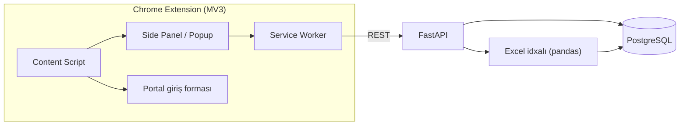
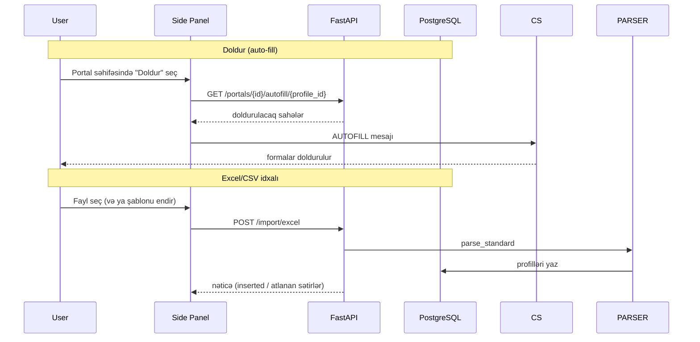

# TaxPro

Azərbaycanın dövlət və bank portalları üçün Chrome uzantısı. Seçilmiş profil məlumatlarını
(Asan ID, VÖEN, telefon, PIN/PUK və s.) portal giriş formalarını avtomatik doldurur, profilləri
idarə edir və Excel/CSV faylından toplu profil idxalını təmin edir.

## Xüsusiyyətlər

- **Portal Auto-fill** — "Doldur" tab-ı: aktiv səhifədəki portal üçün seçilmiş profilin sahələrini formalara yazır.
- **Qeydiyyat rejimi** — istifadəçi portal formasında sahə seçir, selector eşləmələri DB-yə yazılır (dəfələrlə istifadə üçün).
- **Profil idarəetməsi** — CRUD, rəng/ikon seçimi; PIN/PUK Fernet ilə şifrələnir, siyahılarda maskalanır.
- **Excel idxalı** — tək formatlı deterministik emal (.xlsx/.xls/.csv); telefon normallaşdırması, tarix dəstəyi, əskik-sütun xətası dəqiq göstərilir; nümunə şablon endirmə.
- **30 portal** üçün domen əsaslı favicon + statik logo override-ları (hərf-avatar fallback ilə).

## Arxitektura



## Fayl strukturu

```
taxpro-backend/
├── app/
│   ├── api/v1/endpoints/    # REST: profiles, portals, import/excel (+ şablon)
│   ├── core/                # config (pydantic-settings), database, security (Fernet), logging
│   ├── models/              # SQLAlchemy: Profile, Portal
│   ├── schemas/             # Pydantic v2 sxemləri
│   ├── services/deterministic/  # excel_parser, autofill_service, portal_service, profile_service
│   └── main.py
├── alembic/versions/        # Miqrasiyalar 0001–0010 (seed + URL/logo düzəlişləri)
├── tests/                   # pytest inteqrasiya testləri (conftest real DB)
├── Dockerfile · alembic.ini · requirements.txt · .env.example

taxpro-extension/
├── manifest.json            # Manifest V3
├── background.js            # Service worker (tab, autofill, record)
├── content-scripts/autofill.js  # Səhifəyə enjeksiya
├── popup/                   # Side panel UI: popup.html/css/js, tabs/import.js
├── options/                 # Tənzimləmələr (backend URL)
├── lib/api.js               # REST müştərisi
└── assets/icons/            # Brend ikonları (16/32/48/128)
```

## Texnologiyalar

| Təbəqə | Texnologiya |
|---|---|
| API | FastAPI, Pydantic v2, SQLAlchemy v2 (async) |
| DB | PostgreSQL, Alembic |
| Emal | pandas + openpyxl (Excel/CSV idxalı), cryptography (Fernet) |
| Infra | Docker (backend) |
| Extension | Manifest V3, vanilla JS, Chrome Side Panel API |

## İş axını



## Təhlükəsizlik qeydləri

- **Şifrələmə:** PIN/PUK kimi gizli sahələr Fernet (`ENCRYPTION_KEY`) ilə şifrələnir (`enc:` prefiks).
- **Maskalama:** siyahı/oxu cavablarında gizli sahələr `****` kimi qayıdır; şifrə yalnız autofill zamanı açılır.
- **Autofill yalnız seçimlə:** doldurma məhz istifadəçinin seçdiyi profil + aktiv portal cütü üçün baş verir.

## Dəstəklənən Portallar (30)

**Dövlət (9):** e-Vergi, Vergi xidməti, e-Sosial, e-customs, Statistika, AYNA, myGov, MyGovID, Asan İmza Portalı

**Banklar (21):** ABB, Access Bank, AFB Bank, Azər-Türk Bank, Bank Avrasiya, Bank of Baku, Bank Respublika,
Birbank Biznes, BMI Baku, BTB Bank, Expressbank, PashaBank Digital, Premium Bank, Rabitabank, Turanbank,
Unibank, VTB Bank, Xalq Bank, Yapı Kredi Bank, Yelo Bank, Ziraat Bank
