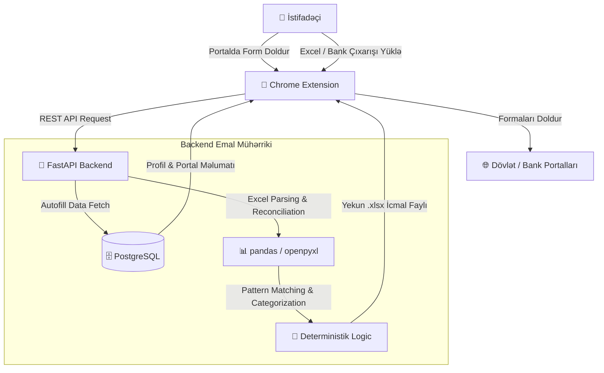

# 🚀 TaxPro

> **Azərbaycanın dövlət və bank portalları üçün ağıllı Chrome uzantısı və avtomatlaşdırılmış maliyyə/mühasibat platforması.**

--- 

## 💡 Nə edir?
 
TaxPro portal girişlərində vaxt itkisini aradan qaldırır və mühasibatlıq/maliyyə hesablaşmalarını tam deterministik (AI/ML olmadan, 100% dəqiq) şəkildə avtomatlaşdırır.

- ⚡ **Avto-Doldurma:** Dövlət və bank portallarında *Telefon* və *Asan ID* məlumatlarını tək kliklə doldurur.
- 🏦 **Bank Çıxarışı Kateqoriyalaşdırması:** 14 yerli bankın fayl formatını avtomatik tanıyır və əməliyyatları 18 kateqoriya üzrə təsnif edir.
- 📊 **Kreditor və Debitor Uzlaşdırması:** Satınalma/satış qaimələrini, bank çıxarışlarını və depozit ödənişlərini VÖEN üzrə avtomatik üst-üstə salır, qalıqları hesablayır.

---
 
## ✨ Əsas Xüsusiyyətlər

| Modul | Təsvir |
| :--- | :--- |
| **🔑 Portal Auto-Fill** | Active tab-da olan portalı tanıyır, seçilmiş profilin məlumatlarını formaya yazır. |
| **📄 Profil İdarəetməsi** | Profil yaradılması (Ad, Telefon, Asan ID) və Excel/CSV vasitəsilə kütləvi idxal. |
| **📑 Bank Çıxarışları** | YapıKredi, ABB, PAŞA, Kapital, Yelo və s. daxil olmaqla 14 bank formatının avtomatik emalı. |
| **🧾 Kreditorlar (Gələn)** | Gələn qaimələr + Bank/Depozit məxarici uzlaşdırılır (`Hesablanıb - Ödənilib = Qalıq`). |
| **📈 Debitorlar (Gedən)** | Göndərilən qaimələr + Bank/Depozit mədaxili uzlaşdırılır. |
| **🏛️ 30+ Portal Dəstəyi** | e-Vergi, e-Sosial, e-Customs, Birbank Biznes, PAŞA Digital və b. |

---

## 🔄 İnteqrasiya Axını (Workflow)



---

## 📂 Layihə Strukturu

```text
TaxPro/
├── 🧠 taxpro-backend/         # FastAPI REST API & Deterministik Emal Mühərriki
│   ├── 📁 app/
│   │   ├── 📁 api/v1/         # Profiles, Portals, Bank Statements & Reconciliation API
│   │   ├── 📁 models/         # Database Modelləri (SQLAlchemy)
│   │   └── 📁 services/       # Excel parsing & Deterministik məntiq
│   ├── 📁 alembic/            # Verilənlər bazası miqrasiyaları
│   └── 📁 tests/              # Pytest inteqrasiya testləri (300+ test)
│
└── 🧩 taxpro-extension/       # Chrome Uzantısı (Manifest V3)
    ├── 📁 popup/              # Side Panel UI & Tablar
    ├── 📁 content-scripts/    # Portallara auto-fill inject edən skriptlər
    └── 📁 background.js       # Background Service Worker
```

---

## 🛠️ Texnologiya Steki

- **Backend:** Python, FastAPI, Pydantic v2, SQLAlchemy v2 (Async)
- **Data & Excel:** pandas, openpyxl
- **Database:** PostgreSQL, Alembic
- **Extension:** JavaScript (ES6+), Manifest V3, Chrome Side Panel API
- **DevOps:** Docker, Docker Compose

---

## ⚡ İşi Salmaq (Quick Start)

```bash
# 1. Repozitoriyanı klonlayın
git clone [https://github.com/nihat2001/TaxPro.git](https://github.com/nihat2001/TaxPro.git)
cd TaxPro/taxpro-backend

# 2. Bazanı və Backend-i Docker ilə işə salın
docker compose up -d --build backend

# 3. Chrome uzantısını yükləyin
# chrome://extensions -> Developer mode -> Load unpacked -> 'taxpro-extension' qovluğunu seçin
```
